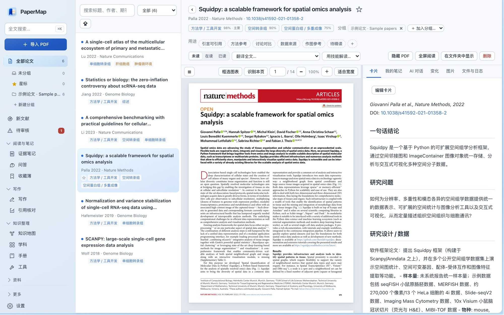
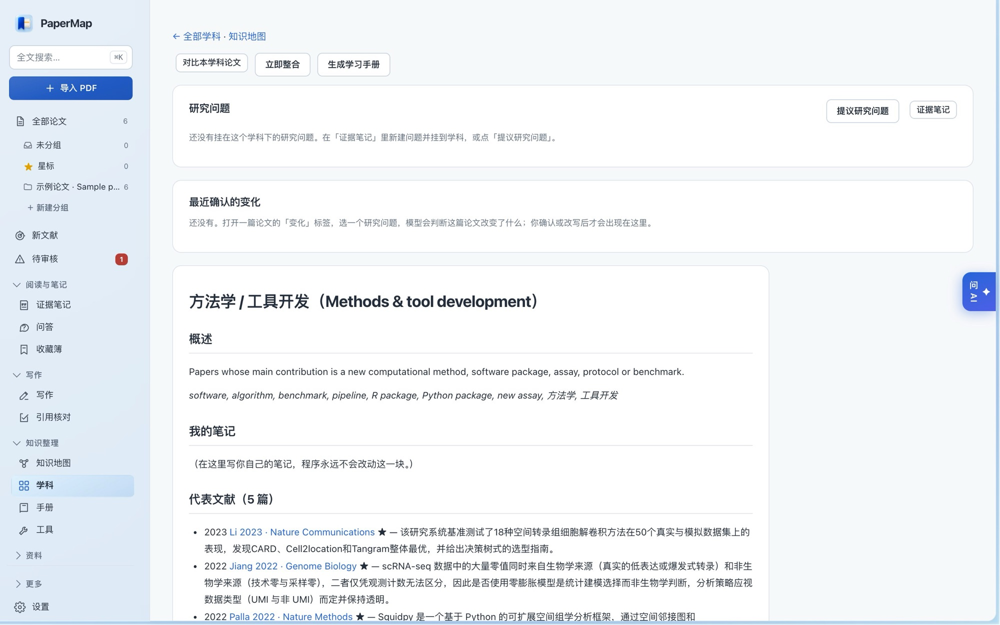

<h1 align="center">PaperMap · a local knowledge map of your papers</h1>

<h3 align="center">Turn the papers you read into a knowledge map that keeps growing by itself</h3>

<p align="center">
  Papers, cards, notes and conversations stay on your own computer. Import a PDF and PaperMap writes a card, classifies it and updates the field pages; discuss the original text with an AI while you read, and check every citation while you write.
</p>

<p align="center">
  <a href="README.md">中文</a> | <b>English</b>
</p>

<p align="center">
  
  
  
  <a href="LICENSE"></a>
</p>

<p align="center">
  
  <br/><sub>Read the PDF on the left, with the generated paper card on the right; switch to AI chat to ask while you read. Screenshots use the built-in open-access sample papers.</sub>
</p>

If PaperMap helps you, please give it a **⭐ Star** – and consider [sponsoring](#sponsor) its development.

---

## Why PaperMap

Reading the literature often goes like this:

* **You forget what you read.** After a few dozen papers you no longer remember which one said what, with which method or sample size.
* **Knowledge is scattered.** Papers in Zotero, notes in Obsidian, AI discussions in a browser tab – none of them connected.
* **You assemble the big picture by hand.** Which paradigms a field uses, which results contradict each other, where evidence is missing.
* **You are unsure when you write.** Does the paper cited after this sentence really say that?

PaperMap runs on your own computer. It reads every paper into a structured card, classifies it by research paradigm and topic, keeps a page for every field that updates as new papers arrive, and links every statement back to the sentence in the PDF.

---

## Features at a glance

| | What it does |
|---|---|
| 📥 **Import** | Drag in PDFs, watch folders (including Zotero, read-only), or **paste a DOI / PMID / PMCID / arXiv ID** to fetch open-access full text; DOI detection, de-duplication, preprint ↔ published merging |
| 🗂 **Organise** | Structured paper cards, multi-label classification (method × topic), field pages, new-field detection with handbooks, knowledge map |
| 📖 **Read** | Built-in reader (highlights, notes, OCR, figure regions), paragraph-by-paragraph full-text translation, selection translation, ask AI while reading |
| 🔎 **Evidence** | Quote sentences per research question, evidence comparison table, "what did this paper change", evidence gaps, version checks |
| 🖼 **Resources** | Figure library (filter by plot type and tag, keep reference figures), data resources (GEO / SRA / EGA… accessions), citation network |
| 🛰 **Tracking** | Daily new papers from OpenAlex, PubMed and bioRxiv / medRxiv, each with the reason it was suggested |
| ✍️ **Writing** | Cited paragraphs written only from papers you pick, sentence-by-sentence **citation check**, BibTeX / RIS / Word export |
| 🤖 **AI** | "Ask AI" beside every page, **agent squads** for reviews and evidence checks, skills, daily / weekly / monthly recaps |
| 🔒 **Local** | Markdown knowledge base (opens in Obsidian), automatic backups and sync, read-only MCP endpoint, four interface languages |

In detail:

### 1. Import and it's organised
* **Three ways in.** Drag PDFs into the window; let PaperMap watch a folder (Zotero's `storage` too – read-only); or click **#** in the sidebar (or just press ⌘V on any page) and **paste DOIs, PubMed IDs, PMC IDs, arXiv IDs or links to them** – a whole list at once, or paste a whole reference list / choose a BibTeX or RIS file to look entries up and tick what to import. Papers with a legal open-access PDF (PMC's official archive, OpenAlex, arXiv) are downloaded and imported; the rest wait under "To download" and a PDF you drag in later is matched by DOI.
* **Detection and de-duplication.** DOIs are read from PDF metadata and the first two pages and checked against Crossref / OpenAlex; renamed copies and preprint / published versions of one work share one card. Supplements are skipped; theses without a DOI are matched by title and file fingerprint.
* **Paper cards.** One-sentence takeaway, research question, study design (sample size, species, tissue, platform, cohort), methods and software, key findings, limitations. Edit a card directly and roll back to any earlier version; "My notes" is never touched by PaperMap.
* **Multi-label classification.** Methods (single-cell, spatial transcriptomics, wet-lab, clinical cohort, prediction model, Mendelian randomisation…) × topics, with a taxonomy you edit in the app; uncertain labels go to Review (accept or reject them in bulk), and a changed taxonomy can be re-applied in one click.

### 2. Knowledge map, fields and handbooks
* **Interactive knowledge map** of fields, papers, research questions and in-library citations.
* **Field pages**: overview, key papers, common tools, methodological progress, **conflicting results**, links to other fields; new papers are appended and the model consolidates the page every few papers, with recently confirmed changes listed separately.
* **New-field detection**: directions your taxonomy doesn't cover are proposed once enough papers collect (create / merge / reject), and a **handbook** is written: part A cites only papers in your library, part B is background marked "to verify".
* **Tool pages** for software used by several papers.

### 3. Think while you read
* **Built-in PDF reader**: outline, search, highlight and underline, notes, figure regions, on-device OCR for scans, supplementary PDFs, preprint / published switching.
* **Translation**: full-text parallel translation and selection translation via bilibili Index-Translate (free), your main model, NiuTrans, Zhipu, Tencent Hunyuan or a custom API; taxonomy synonyms, tool and gene names go in as a glossary; interrupted jobs resume, and omissions are detected and patched paragraph by paragraph. Targets: Simplified and Traditional Chinese, English, German, Japanese, Korean, French, Spanish.
* **Ask AI** beside a paper with any configured model; answers cite pages you can click. Select text in the PDF or translation, or open a figure, and ask about it. Every page has an "Ask AI" drawer; key points go into your notes only after you confirm.
* **Right-click**: highlight, colour or bold text in a card; "Save this sentence" anywhere. The **clippings** page groups saved sentences into topics every week, each with its source.
* **Skills**: prompt-only skills such as "Close reading" for an in-depth reading of one paper (no scripts are run).

### 4. Evidence and research questions
* **Evidence notes**: quote sentences or figure regions (anchored to page and position) under research questions, marked supports / opposes / to check; one quote can serve several questions.
* **Evidence comparison**: papers side by side by sample source, unit of analysis, method, result and limitation; papers sharing a data accession are listed so you can judge sample overlap.
* **What did this paper change**: an update card compares a new paper with your evidence; fixed impact types (including "does not change the current judgement"), quotes required on both sides, effective only after you confirm.
* **Evidence gaps**: note what is missing; when a new paper may fill a gap you get a reminder and the passages worth reading first.
* **Preprint → published**: both versions are kept, old quotes still point to their page, and changed or missing passages are flagged for you to check.

### 5. Figure library and data resources
* **Figure library**: every figure found by its legend (Extended Data included). Filter by **plot type** (UMAP, spatial maps, heatmaps, volcano plots, survival curves, staining, schematics… 20 types, guessed from the legend, free), by **papers** (starred, purpose tags such as "figure reference", groups, fields), by legend words, or main figures only; more load as you scroll.
* **Reference figures**: keep the one figure you want to draw like, with a note on why (colours, layout, labelling), and export them as a board (images, printable page, Markdown); correct a plot type with one click. The model can explain a figure panel by panel.
* **Data resources**: GEO, SRA, EGA, ArrayExpress, CNGB, GSA, dbGaP, PRIDE, Zenodo, GitHub, TCGA… accessions and code repositories from the full text, marked "generated by this study" or "reused public data"; clickable filters by repository, use and paper scope, search, CSV export.
* **By dataset**: which papers in your library generated or reused each accession, shared datasets first.
* **Citation network**: in-library citations and "papers cited by several of yours that you haven't added yet".

### 6. Track new literature
* Every day, new papers from **OpenAlex, PubMed and bioRxiv / medRxiv** related to your fields, evidence gaps and followed authors, plus new papers citing yours.
* After days offline it catches up from each source's last success; a paper found by several sources appears once, with the reasons; free scoring, then the model ranks the top few dozen.
* "Take in" looks for a legal open-access PDF and imports it the normal way.

### 7. Writing and citation check
* **Writing**: pick papers (starred, purpose tag, group, field) and the model writes a cited paragraph only from their cards, listing missing evidence; export Markdown / Word / BibTeX.
* **Citation check**: upload a Word manuscript; each citing sentence is checked against the cited paper – supported / partly / not found / contradicted – with the source sentence and page. A verdict without a source sentence is not accepted.
* **Library Q&A**, **full-text search** (Chinese and English), **comparison tables**, **BibTeX / RIS export**.

### 8. Agent squads
* Hand larger jobs to a team of agents: **topic review**, **evidence check**, **new-paper triage**, and **deep reading** of one paper from its AI chat. A lead plans the task board, members search and read in parallel, a critic challenges, a writer drafts a sourced report – all visible live, and you can send instructions at any time.
* **Read-only, proposals only**: squads read your library and search outside it; every change (quotes, judgements, gaps, papers to add) comes back as a proposal you accept or reject. Invented quotes are rejected and unsourced sentences removed.
* Each role can use its own model (save subscription quota for hard work, cheap models for simple steps), with a cost estimate and a cap before starting; every two weeks a model can suggest role assignments from public rankings and your usage, which you adopt role by role.

### 9. Recaps
* **What I did today** on the home page: quotes, reading, notes and clippings of the day.
* **Weekly / monthly reports**: what you read, new evidence, questions worth pursuing (open gaps, conflicting evidence, questions in your notes), reading backlog, next week's plan; monthly reports revisit old judgements and point out topics ready to write up. Optional AI summary with numbered links back, and a one-click **lab-meeting outline**.

### 10. Your data stays yours
* The knowledge base is a plain **Markdown folder** (one folder per paper: PDF copy, card, translation, notes) that opens in [Obsidian](https://obsidian.md); state lives in a local SQLite file.
* Daily database backups; optional daily **sync of the whole library to an external drive or cloud folder**; deleted papers stay in the trash for 30 days.
* Interface in **简体中文 / 繁體中文 / English / Deutsch**, following your system by default; generated content has its own language, and existing cards can be regenerated in a new language (with a cost estimate first).
* **⌘K** jump anywhere, "What to read today", status check, costs page and monthly budget.
* Local read-only **MCP server** and plugin API, so tools like Claude Code can query your papers and evidence (127.0.0.1 only, separate tokens).
* Models via **ChatGPT, Claude or Google Antigravity subscriptions**, or DeepSeek, Anthropic, OpenAI, Gemini, Kimi, Zhipu, Qwen APIs, or any OpenAI / Anthropic-compatible service.

<details>
<summary><b>More screenshots (knowledge map, field page, writing, citation check)</b></summary>
<br/>

<p align="center"><br/><sub>Knowledge map: methods (blue), topics (orange), papers (grey) and citations between papers</sub></p>
<p align="center"><br/><sub>Field page: key papers, tools, method progress and conflicting findings, updated as papers arrive</sub></p>
<p align="center"><br/><sub>Writing: a cited passage drafted only from the papers you chose</sub></p>
<p align="center"><br/><sub>Citation check: a verdict per sentence, with the quotation and page</sub></p>
</details>

> **Privacy**: paper text (title, abstract, key sections) is sent to **the model provider you choose**. PDFs in excluded folders (default `_private`, `drafts`) are never read or sent. PaperMap ships with no keys and sends nothing to its author.

---

## Quick start

### Install

**macOS app**: download `PaperMap-macOS-AppleSilicon.zip` (Apple silicon Macs) from [Releases](https://github.com/RongpengGong/PaperMap/releases), unzip and drag `PaperMap.app` into Applications. The app is not notarised yet: if macOS says it cannot verify the developer, allow it under System Settings → Privacy & Security. On Intel Macs and Windows, install with Python for now (below).

**With Python** (3.10+):

```bash
pip install "papermap[desktop] @ git+https://github.com/RongpengGong/PaperMap"
papermap            # creates a configuration on first run and opens the window
```

> The Windows build compiles but has not been fully tested on Windows yet – feedback welcome.

### First use (3 minutes)

1. **Connect a model** in Settings → AI services → Models and accounts: sign in with a **ChatGPT plan**, a **Claude subscription (local Claude Code)** or an **Antigravity subscription (local Google Antigravity CLI)**, or enter an API key for DeepSeek, Anthropic, OpenAI, Gemini, Kimi, Zhipu, Qwen…, or any OpenAI / Anthropic-compatible service. Click **Test connection** before saving.
2. **Import papers**: drag PDFs into the window, or add an import folder under Settings → Library → Import and folders (e.g. Zotero's `storage`, read-only). Batches of 5+ papers show a cost estimate first.
3. **No papers yet?** Click "Import sample papers" on the welcome card, in the guide or in the empty paper list: PaperMap downloads 6 CC BY papers from the PMC open-access collection into their own group.
4. **Open the Guide** (under More in the sidebar) and press **⌘K** to jump anywhere. "More → Report a problem" builds a report with private details removed; the sidebar tells you when a new version is out (see the [release notes](docs/releases/)).

**Cost**: with DeepSeek, a long paper (card + classification) costs less than one US cent; ChatGPT / Claude subscriptions add no extra cost. You can set a monthly budget.

More details – every page, translation services, plugins and MCP, command line, start at login, where data lives – are in **[docs/USAGE.en.md](docs/USAGE.en.md)**.

---

## Development

```bash
git clone https://github.com/RongpengGong/PaperMap && cd PaperMap
python -m venv .venv && .venv/bin/pip install -e ".[dev,desktop]"
.venv/bin/python -m pytest -q          # 500+ tests
.venv/bin/papermap serve --port 8799   # web UI only, for debugging in a browser
.venv/bin/pip install -e ".[build]" && .venv/bin/python packaging/build.py   # build the desktop app
```

The design document and decision log (in Chinese) is [CLAUDE.md](CLAUDE.md). Issues and pull requests are welcome.

---

## Sponsor

PaperMap is a personal side project, free and open source. If it saves you time, you can buy the author a coffee ☕

<table align="center">
  <tr>
    <td align="center"><br><sub>PayPal</sub></td>
    <td align="center"><br><sub>WeChat Pay</sub></td>
    <td align="center"><br><sub>Alipay</sub></td>
  </tr>
</table>

---

## Acknowledgements

* Metadata from [Crossref](https://www.crossref.org/) and [OpenAlex](https://openalex.org/); new literature from OpenAlex, [PubMed](https://pubmed.ncbi.nlm.nih.gov/) and [bioRxiv / medRxiv](https://www.biorxiv.org/); open-access full text from [PMC Open Access](https://pmc.ncbi.nlm.nih.gov/tools/openftlist/).
* PDF parsing with [PyMuPDF](https://pymupdf.readthedocs.io/), the note editor is built on [Tiptap](https://tiptap.dev/), the desktop window on [pywebview](https://pywebview.flowrl.com/).
* Thanks to [Claude](https://claude.ai) (Anthropic) for help during development.

## License

See [LICENSE](LICENSE). Third-party components and their licenses are listed in [THIRD_PARTY_NOTICES.md](THIRD_PARTY_NOTICES.md).
