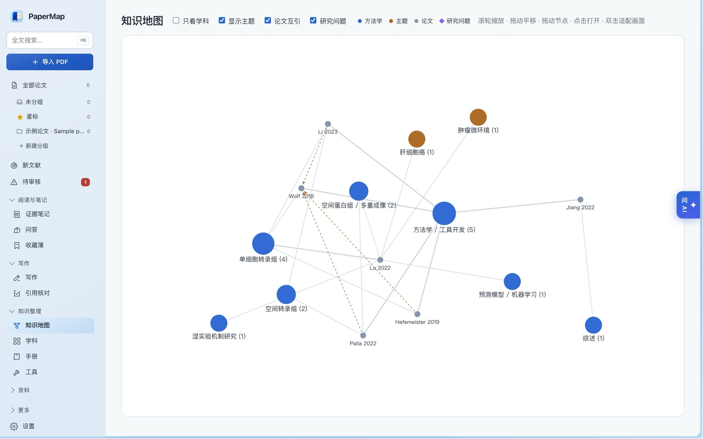
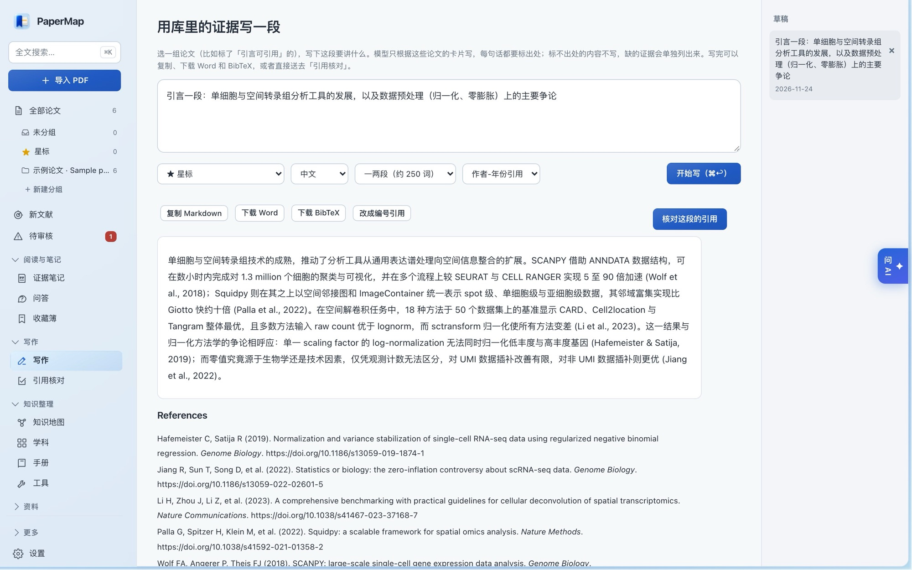
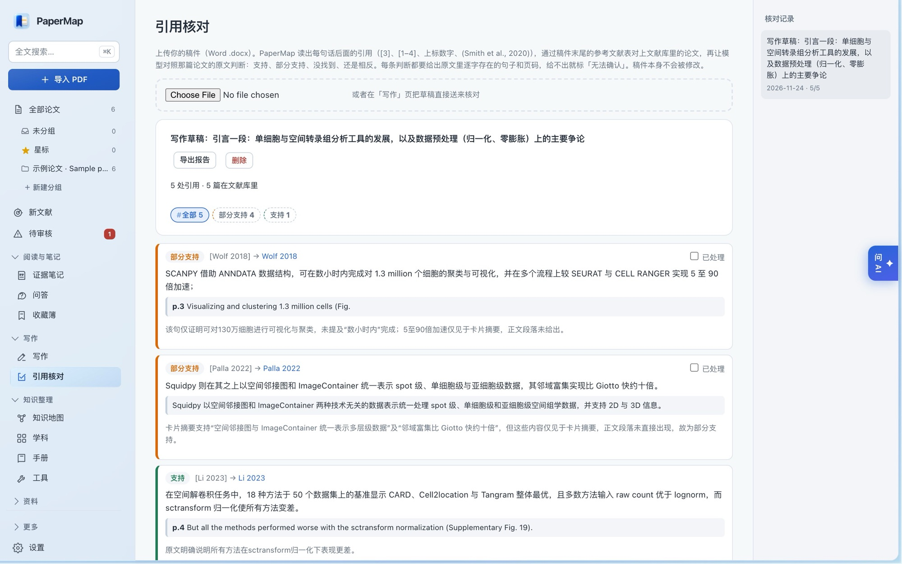

<h1 align="center">PaperMap · a local knowledge map of your papers</h1>

<h3 align="center">Turn the papers you read into a knowledge map that keeps growing by itself</h3>

<p align="center">
  Papers, cards, notes and conversations stay on your own computer. Import a PDF and PaperMap writes a card, classifies it and updates the field pages; discuss the original text with an AI while you read, and check every citation while you write.
</p>

<p align="center">
  <a href="README.md">中文</a> | <b>English</b>
</p>

<p align="center">
  
  
  
  <a href="LICENSE"></a>
</p>

<p align="center">
  
  <br/><sub>Read the PDF on the left, with the generated paper card on the right; switch to AI chat to ask while you read. Screenshots use the built-in open-access sample papers.</sub>
</p>

If PaperMap helps you, please give it a **⭐ Star** – and consider [sponsoring](#sponsor) its development.

---

## Why PaperMap

Reading the literature often goes like this:

* **You forget what you read.** After a few dozen papers you no longer remember which one said what, with which method or sample size.
* **Knowledge is scattered.** Papers in Zotero, notes in Obsidian, AI discussions in a browser tab – none of them connected.
* **You assemble the big picture by hand.** Which paradigms a field uses, which results contradict each other, where evidence is missing.
* **You are unsure when you write.** Does the paper cited after this sentence really say that?

PaperMap runs on your own computer. It reads every paper into a structured card, classifies it by research paradigm and topic, keeps a page for every field that updates as new papers arrive, and links every statement back to the sentence in the PDF.

---

## Features

### 1. Import and it's organised
* **Just drop PDFs in**, or let PaperMap watch a folder (Zotero's storage folder too – read-only, nothing is moved or renamed).
* **Identification and de-duplication**: DOI checked against Crossref / OpenAlex; renamed copies and preprint vs. published versions share one card.
* **Paper cards**: one-sentence takeaway, study design (samples, species, platforms), methods and software, key findings, limitations. Cards are editable, with a version history to go back to.
* **Multi-label classification**: method (single-cell, spatial transcriptomics, wet lab, clinical cohort…) × topic (your own taxonomy); uncertain labels go to Review.

### 2. Knowledge map and fields
* **Interactive knowledge map** of fields, papers and research questions.
* **Field pages**: key papers, common tools, method progress and **conflicting findings**; new papers are appended and the page is periodically consolidated.
* **New-field detection**: when a direction outgrows your taxonomy, PaperMap proposes a field and writes a **study handbook** (part A cites only your library; part B is labelled background to verify).

### 3. Think while you read
* **Built-in PDF reader**: outline, search, highlights, notes, figure/table capture, on-device OCR, select-to-translate and side-by-side full-text translation.
* **AI chat** next to the paper with any configured model (reasoning effort for ChatGPT / Claude subscriptions); answers cite pages that jump back into the PDF. Select a passage and **Ask AI**. Every other page has an **Ask AI** drawer. When a discussion ends, its points go into your notes only after you confirm.
* **Right-click**: select text in a card to highlight, colour or bold it in place; select anything anywhere to **save it to Clippings**. Clippings are organised into cited knowledge points by AI every week.
* **Skills**: prompt-only skills such as close reading for an in-depth reading of one paper (no scripts are ever run).

### 4. Evidence and research questions
* **Evidence notes**: quote sentences (anchored to page and position) under research questions, mark them supporting / opposing / to check, compare samples, methods and conclusions side by side.
* **What this paper changes**: a new paper is compared with your existing evidence into an update card that must quote both sides; it counts only after you confirm.
* **Evidence gaps**: note what is missing and get reminded when a new paper may fill it, with the passages to read first.
* **Preprint → published**: both versions are kept, old excerpts still open on their original page, and changed or missing passages are flagged for you to check.

### 5. Track new literature
* Daily searches of **OpenAlex, PubMed and bioRxiv / medRxiv** around your fields, evidence gaps and followed authors, plus new papers citing your library.
* Catches up after days offline; one candidate per paper across sources, with the reasons it was suggested; a weekly digest notification.
* **Take in** looks for a legal open-access PDF and imports it normally.

### 6. Writing and citation check
* **Writing**: choose papers (starred, purpose tag, group, field) and the model drafts a passage only from them, citing every claim and listing missing evidence; export Word / BibTeX.
* **Citation check**: upload a Word manuscript; each citing sentence is checked against the cited paper's own text – supports / partly / not found / contradicts – with a verbatim quotation and page. Judgements without a verifiable quotation are not accepted.
* Also: **ask your library**, **full-text search**, **comparison tables**, **data resources** (GEO / SRA accessions…), **citation network**, **BibTeX / RIS export**.

### 7. Your data stays yours
* The knowledge base is a plain **Markdown folder** you can open in [Obsidian](https://obsidian.md); state lives in a local SQLite database.
* Daily database backups, optional daily **mirror of the whole knowledge folder** to an external drive or cloud folder, and a 30-day trash.
* **⌘K** quick jump, collapsible sidebar, "What to read today", a status page, and a Simplified Chinese / Traditional Chinese / English / German interface.
* A local read-only **MCP server** and plugin API so tools like Claude Code can query your evidence (listens on 127.0.0.1 only).

<details>
<summary><b>More screenshots (knowledge map, field page, writing, citation check)</b></summary>
<br/>

<p align="center"><br/><sub>Knowledge map: methods (blue), topics (orange), papers (grey) and citations between papers</sub></p>
<p align="center"><br/><sub>Field page: key papers, tools, method progress and conflicting findings, updated as papers arrive</sub></p>
<p align="center"><br/><sub>Writing: a cited passage drafted only from the papers you chose</sub></p>
<p align="center"><br/><sub>Citation check: a verdict per sentence, with the quotation and page</sub></p>
</details>

> **Privacy**: paper text (title, abstract, key sections) is sent to **the model provider you choose**. PDFs in excluded folders (default `_private`, `drafts`) are never read or sent. PaperMap ships with no keys and sends nothing to its author.

---

## Quick start

### Install

**macOS / Windows app**: download the matching zip from [Releases](https://github.com/RongpengGong/PaperMap/releases) (`AppleSilicon`, `Intel` or `Windows`). On macOS, unzip and drag `PaperMap.app` into Applications. The app is not notarised yet: if macOS says it cannot verify the developer, allow it under System Settings → Privacy & Security.

**With Python** (3.10+):

```bash
pip install "papermap[desktop] @ git+https://github.com/RongpengGong/PaperMap"
papermap            # creates a configuration on first run and opens the window
```

> The Windows build compiles but has not been fully tested on Windows yet – feedback welcome.

### First use (3 minutes)

1. **Connect a model** in Settings → AI services → Models and accounts: sign in with a **ChatGPT plan** or a **Claude subscription (local Claude Code)**, or enter an API key for DeepSeek, Anthropic, OpenAI, Gemini, Kimi, Zhipu, Qwen…, or any OpenAI / Anthropic-compatible service. Click **Test connection** before saving.
2. **Import papers**: drag PDFs into the window, or add an import folder under Settings → Library → Import and folders (e.g. Zotero's `storage`, read-only). Batches of 5+ papers show a cost estimate first.
3. **No papers yet?** Click "Import sample papers" on the welcome card, in the guide or in the empty paper list: PaperMap downloads 6 CC BY papers from the PMC open-access collection into their own group.
4. **Open the Guide** (under More in the sidebar) and press **⌘K** to jump anywhere. "More → Report a problem" builds a report with private details removed; the sidebar tells you when a new version is out.

**Cost**: with DeepSeek, a long paper (card + classification) costs less than one US cent; ChatGPT / Claude subscriptions add no extra cost. You can set a monthly budget.

More details – every page, translation services, plugins and MCP, command line, start at login, where data lives – are in **[docs/USAGE.en.md](docs/USAGE.en.md)**.

---

## Development

```bash
git clone https://github.com/RongpengGong/PaperMap && cd PaperMap
python -m venv .venv && .venv/bin/pip install -e ".[dev,desktop]"
.venv/bin/python -m pytest -q          # 400+ tests
.venv/bin/papermap serve --port 8799   # web UI only, for debugging in a browser
.venv/bin/pip install -e ".[build]" && .venv/bin/python packaging/build.py   # build the desktop app
```

The design document and decision log (in Chinese) is [CLAUDE.md](CLAUDE.md). Issues and pull requests are welcome.

---

## Sponsor

PaperMap is a personal side project, free and open source. If it saves you time, you can buy the author a coffee ☕

<table align="center">
  <tr>
    <td align="center"><br><sub>PayPal</sub></td>
    <td align="center"><br><sub>WeChat Pay</sub></td>
    <td align="center"><br><sub>Alipay</sub></td>
  </tr>
</table>

---

## Acknowledgements

* Metadata from [Crossref](https://www.crossref.org/) and [OpenAlex](https://openalex.org/); new literature from OpenAlex, [PubMed](https://pubmed.ncbi.nlm.nih.gov/) and [bioRxiv / medRxiv](https://www.biorxiv.org/); open-access full text from [PMC Open Access](https://pmc.ncbi.nlm.nih.gov/tools/openftlist/).
* PDF parsing with [PyMuPDF](https://pymupdf.readthedocs.io/), the note editor is built on [Tiptap](https://tiptap.dev/), the desktop window on [pywebview](https://pywebview.flowrl.com/).
* Thanks to [Claude](https://claude.ai) (Anthropic) for help during development.

## License

See [LICENSE](LICENSE). Third-party components and their licenses are listed in [THIRD_PARTY_NOTICES.md](THIRD_PARTY_NOTICES.md).
