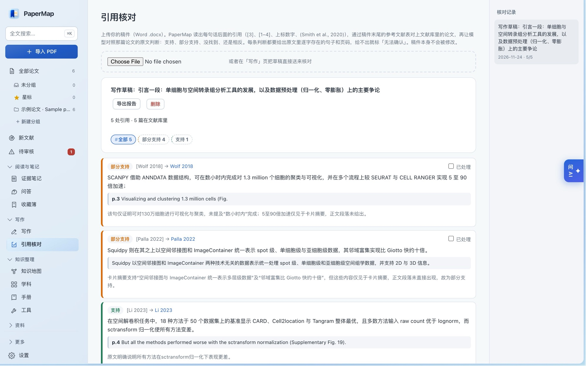

<h1 align="center">PaperMap · 本地文献知识地图</h1>

<h3 align="center">把你读过的论文，变成一张会自己长大的知识地图</h3>

<p align="center">
  论文、卡片、笔记和对话都保存在你自己的电脑上。导入 PDF 后自动写卡片、分类、建学科页；读的时候和 AI 讨论原文，写的时候逐句核对引用。
</p>

<p align="center">
  <b>中文</b> | <a href="README.en.md">English</a>
</p>

<p align="center">
  
  
  
  <a href="LICENSE"></a>
</p>

<p align="center">
  
  <br/><sub>左边读原文，右边是自动生成的论文卡片；也可以切到「AI 对话」边读边问。截图来自内置的开放获取示例论文。</sub>
</p>

如果 PaperMap 对你有帮助，欢迎点右上角的 **⭐ Star**，也欢迎[赞助](#赞助)支持后续开发。

---

## 为什么做 PaperMap

读文献的人常常遇到这些问题：

* **读过就忘。** 读了几十篇，过几个月想不起哪篇说了什么、用的什么方法、样本多大。
* **知识是零散的。** 论文在 Zotero，笔记在 Obsidian，和 AI 的讨论留在网页里，彼此串不起来。
* **领域全貌要自己拼。** 一个方向有哪些研究范式、哪些结论互相矛盾、哪里还缺证据，只能从头梳理。
* **写作时心里没底。** 稿件里这句话后面引的那篇，原文真的这么说吗？

PaperMap 在你自己的电脑上运行。它把每篇论文读成一张结构化卡片，按研究范式和主题归类，为每个学科维护一个随新论文更新的页面，并且让每个结论都能点回 PDF 里的原句。

---

## 功能一览

| | 能做什么 |
|---|---|
| 📥 **导入** | 拖入 PDF、监听文件夹（含 Zotero，只读）、**粘贴 DOI / PMID / PMCID / arXiv 编号**自动下载开放获取全文；自动识别 DOI、去重、合并预印本与正式版 |
| 🗂 **整理** | 结构化论文卡片、方法学 × 主题多标签分类、学科页、新学科检测与学习手册、知识地图 |
| 📖 **阅读** | 内置阅读器（高亮、批注、OCR、框选图表）、全文段落对照翻译、划词翻译、边读边问 AI |
| 🔎 **证据** | 围绕研究问题摘录原句、证据对照表、「这篇论文改变了什么」、证据缺口、版本核对 |
| 🖼 **资料** | 图片库（按图型和标签筛选、收藏参考图）、数据资源表（GEO / SRA / EGA… 登录号）、引用网络 |
| 🛰 **追踪** | 每天从 OpenAlex、PubMed、bioRxiv / medRxiv 找相关新论文，写明推荐理由 |
| ✍️ **写作** | 只用你选的论文写带引用的段落、逐句**引用核对**、BibTeX / RIS / Word 导出 |
| 🤖 **AI** | 页面旁的「问 AI」、**智能体小队**分工完成综述和核对、技能解读、日 / 周 / 月回顾 |
| 🔒 **本机** | Markdown 知识库（可用 Obsidian 打开）、自动备份与同步、只读 MCP 接口、四种界面语言 |

下面逐项说明。

### 1. 导入即整理
* **三种导入方式。** 把 PDF 拖进窗口；或让 PaperMap 监听一个文件夹（包括 Zotero 的 `storage`，只读不改）；或点侧边栏的 **#**（任意页面直接 ⌘V 也行），**粘贴 DOI、PubMed ID、PMC ID、arXiv 编号或它们的链接**，一次可以贴一整串。也可以贴一整段参考文献表或选择 BibTeX / RIS 文件，先逐条查找再勾选导入。有合法开放获取全文的（PMC 官方仓库、OpenAlex、arXiv）自动下载导入；没有的放进「待下载」，之后拖进 PDF 会按 DOI 自动对上。
* **识别与去重。** 从 PDF 元数据和前两页读出 DOI，到 Crossref / OpenAlex 核对标题；改名副本、同一作品的预印本和正式版只保留一张卡片。补充材料自动跳过，无 DOI 的学位论文按标题和文件指纹去重。
* **论文卡片。** 一句话结论、研究问题、研究设计（样本量、物种、组织、平台、队列）、方法与软件、主要发现、局限。卡片可以直接编辑，改坏了能退回任何历史版本；「我的笔记」程序永远不会改动。
* **多标签分类。** 方法学（单细胞、空间转录组、湿实验、临床队列、预测模型、孟德尔随机化……）× 主题，分类表可以在应用里编辑；拿不准的进「待审核」（可以批量接受或拒绝），改了分类表可以一键重新分类。

### 2. 知识地图、学科与手册
* **交互式知识地图**：学科、论文、研究问题和库内互引画在一张图上，可以只看学科。
* **学科页**：概述、代表文献、常用工具、方法进展、**相互矛盾的结论**、与其他学科的交叉；新论文自动追加，每攒够一批由模型整合一次，最近确认的证据变化单独列出。
* **新学科检测**：分类表覆盖不到的方向攒够几篇后提示你建立 / 合并 / 拒绝，建立后生成**学习手册**：A 部分只写你库里有 DOI 出处的内容，B 部分是标明「需核实」的背景知识。
* **工具页**：被多篇论文用到的软件包，各自一页。

### 3. 边读边想
* **内置 PDF 阅读器**：目录、搜索、高亮与下划线、批注、框选图表、本机 OCR（扫描版）、补充材料 PDF、预印本 / 正式版切换。
* **翻译**：全文段落对照翻译（一段原文一段译文）和划词翻译。可选 bilibili Index-Translate（免费）、主模型、小牛、智谱、腾讯混元或自定义接口；分类表同义词、工具名、基因名作为术语表传入；中断后接着翻，并自动检查漏译、只补缺的段落。可以翻成简体、繁体、英、德、日、韩、法、西。
* **问 AI**：论文旁边和任意已配置的模型讨论，回答标页码、点击跳回 PDF；选中 PDF 或译文里的一段、或打开一张图，都能直接提问。每个页面右侧都有「问 AI」抽屉。讨论结束后，要点经你确认才写进笔记。
* **右键即用**：卡片里选中文字直接高亮、改颜色、加粗；任何地方选中都能「收藏这句」，**收藏簿**每周按主题归纳成知识点，每条标出处。
* **技能**：用「精读」等纯提示词技能深度解读一篇论文（不执行任何脚本）。

### 4. 证据与研究问题
* **证据笔记**：围绕研究问题摘录原句或图表区域（锚定到页码和位置），标「支持 / 相反 / 待核对」；同一段证据可以用于多个问题。
* **证据对照**：逐篇并排比较样本来源、分析单位、方法、结果和局限；提到同一数据登录号的论文会被列出来，由你判断样本是否重叠。
* **这篇论文改变了什么**：新论文对照已有证据生成「更新卡」，影响类型固定（包括「未改变当前判断」），新旧两边都要引用原文，由你确认才进入学科页。
* **证据缺口**：记下还缺什么证据；新论文可能补上时提醒你，并给出值得先读的段落。
* **预印本 → 正式版**：两个版本并存，旧摘录仍指向原页；改动或消失的段落会提示你核对。

### 5. 图片库与数据资源
* **图片库**：按图注自动找出每篇论文的图（含 Extended Data）。可以点选**图型**（UMAP、空间分布图、热图、火山图、生存曲线、染色、示意图等 20 类，按图注判断，免费）、**论文范围**（星标、用途标签如「作图参考」、分组、学科）、图注关键词、只看正文图，滚动自动加载。
* **参考图**：作图时想留的那一张，点「收藏为参考图」，写一句为什么（配色、排版、标注方式），可以导出成参考图板（图片 + 可打印网页 + Markdown）；自动判断错的图型可以点一下改正。模型可以逐个面板讲解一张图。
* **数据资源表**：从全文提取 GEO、SRA、EGA、ArrayExpress、CNGB、GSA、dbGaP、PRIDE、Zenodo、GitHub、TCGA 等登录号和代码仓库，区分「本研究产生」和「引用的公开数据」；按来源、用途、论文范围点选筛选，可搜索、导出 CSV。
* **按数据集查看**：同一个登录号被库里哪些论文产生或引用，被多篇论文用到的排在前面。
* **引用网络**：库内互引、被你库里多篇论文反复引用但你还没收的「漏读提醒」。

### 6. 追踪新文献
* 每天从 **OpenAlex、PubMed、bioRxiv / medRxiv** 查找与你的学科、证据缺口、关注作者相关的新论文，以及引用了你库里论文的新文章。
* 关机几天后从各来源上次成功的位置补查；同一篇被多个来源发现只出现一次，并写明推荐理由；免费打分后由模型精排前几十篇。
* 「收进来」时自动寻找合法的开放获取 PDF，走正常导入流程。

### 7. 写作与引用核对
* **写作**：选一组论文（星标、用途标签、分组、学科），模型只根据它们的卡片写一段带引用的文字，缺的证据单独列出；导出 Markdown / Word / BibTeX。
* **引用核对**：上传 Word 稿件，逐句检查被引论文是否真的支持这句话：支持 / 部分支持 / 没找到 / 相反，每条给出原文句子和页码；给不出原句的判断不被采信。
* **全库问答**、**全文搜索**（中英文都能搜）、**对比表**、**BibTeX / RIS 导出**。

### 8. AI 智能体小队
* 把大一点的活交给一组分工的智能体：**课题综述**、**证据核对**、**新文献分诊**，以及论文对话里的**单篇深读**。队长拆任务、成员并行检索和精读、质疑员挑毛病、执笔员写带出处的报告，过程实时可见，可以随时追加指令。
* **只读 + 提议**：小队只能读文献库和检索库外，所有改动（摘录、判断、缺口、收录）都作为提议交给你确认；编造的原句会被拒绝，没有出处的句子会被删掉。
* 每个角色可以用不同的模型（订阅额度留给难的活，简单的用便宜模型），开始前估算费用并设上限；每两周可以让一个模型按排行榜和使用记录建议角色搭配，由你逐项采纳。

### 9. 回顾
* **今天做了什么**：首页列出当天的摘录、阅读、笔记和收藏。
* **周报 / 月报**：读了什么、新摘录、值得追问的问题（未补的缺口、相互矛盾的证据、笔记里的疑问）、阅读积压、下周打算；月报还会回访旧判断、提示「可以写成段落了」。可选一段 AI 小结（每条都编号回链），并能一键生成**组会大纲**。

### 10. 数据始终在你手里
* 知识库是普通的 **Markdown 文件夹**（每篇论文一个文件夹：PDF 副本、卡片、译文、笔记），可以直接用 [Obsidian](https://obsidian.md) 打开；状态保存在本机 SQLite。
* 每天自动备份数据库；可以把整个知识库每天**同步到移动硬盘或云盘文件夹**；删除的论文进回收站 30 天。
* 界面支持**简体中文 / 繁體中文 / English / Deutsch**，默认跟随系统；卡片、学科页等生成内容的语言单独设置，改了以后可以按新语言批量重新生成（先估算费用）。
* **⌘K** 快速跳转、「今天读什么」、状态检查、费用面板与每月预算。
* 本机只读 **MCP 服务**和插件接口：让 Claude Code 等工具查询你的论文和证据（只监听 127.0.0.1，令牌单独授权）。
* 模型可以用 **ChatGPT、Claude、Google Antigravity 订阅**，或 DeepSeek、Anthropic、OpenAI、Gemini、Kimi、智谱、通义等 API，以及任何 OpenAI / Anthropic 兼容的服务。

<details>
<summary><b>点击展开：更多界面截图（知识地图、学科页、写作、引用核对）</b></summary>
<br/>

<p align="center"><br/><sub>知识地图：方法学（蓝）、主题（橙）、论文（灰）与论文之间的引用</sub></p>
<p align="center"><br/><sub>学科页：代表文献、常用工具、方法进展和相互矛盾的结论，随新论文自动更新</sub></p>
<p align="center"><br/><sub>写作：只用你选的论文写一段带引用的文字</sub></p>
<p align="center"><br/><sub>引用核对：逐句给出判断、原文句子和页码</sub></p>
</details>

> **隐私**：论文文本（标题、摘要、关键章节）会发送到**你自己选择的**模型服务商。放在排除文件夹（默认 `_private`、`drafts`）里的 PDF 不会被读取或发送。PaperMap 不内置任何密钥，也不会把数据发给作者。

---

## 快速开始

### 安装

**macOS 应用**：从 [Releases](https://github.com/RongpengGong/PaperMap/releases) 下载 `PaperMap-macOS-AppleSilicon.zip`（Apple 芯片的 Mac），解压后把 `PaperMap.app` 拖进「应用程序」。应用还没有经过 Apple 公证：第一次打开如果提示无法验证开发者，请到「系统设置 → 隐私与安全性」点「仍要打开」。Intel Mac 和 Windows 目前请用下面的 Python 方式安装。

**用 Python 安装**（Python 3.10+）：

```bash
pip install "papermap[desktop] @ git+https://github.com/RongpengGong/PaperMap"
papermap            # 首次运行会创建配置并打开窗口
```

> Windows 版可以构建，但还没有在 Windows 上完整实测，欢迎反馈问题。

### 第一次使用（3 分钟）

1. **连接模型**：「设置 → AI 服务 → 模型与账号」。可以选择 **ChatGPT 订阅**、**Claude 订阅（本机 Claude Code）** 或 **Antigravity 订阅（本机 Google Antigravity CLI）** 登录，也可以填 DeepSeek、Anthropic、OpenAI、Gemini、Kimi、智谱、通义等的 API Key，或任何 OpenAI / Anthropic 兼容的自定义服务。点「测试连接」看到 ✓ 再保存。
2. **导入论文**：把 PDF 拖进窗口；或在「设置 → 文献库 → 导入与文件夹」加一个自动导入文件夹（比如 Zotero 的 `storage`，只读不改）。一次导入 5 篇以上会先估算费用，等你确认。
3. **还没有论文？** 在欢迎页、使用指南或空的论文列表里点「导入示例论文」，PaperMap 会从 PMC 开放获取库下载 6 篇 CC BY 论文放进单独分组，马上就能看到效果。
4. **看「使用指南」**（左侧「更多」里），按 **⌘K** 随时跳转。遇到问题可以在「更多 → 反馈问题」生成去掉了隐私信息的报告；有新版本时侧边栏底部会提示，更新内容见 [更新公告](docs/releases/)。

**费用**：以 DeepSeek 为例，一篇长文（卡片 + 分类）不到 1 美分；用 ChatGPT / Claude 订阅不另外计费。可以在设置里设每月预算。

更详细的说明（每个页面、翻译服务、插件与 MCP、命令行、开机自启、数据位置、常见问题）见 **[docs/USAGE.md](docs/USAGE.md)**。

---

## 开发

```bash
git clone https://github.com/RongpengGong/PaperMap && cd PaperMap
python -m venv .venv && .venv/bin/pip install -e ".[dev,desktop]"
.venv/bin/python -m pytest -q          # 500+ 个测试
.venv/bin/papermap serve --port 8799   # 只开网页，用浏览器调试
.venv/bin/pip install -e ".[build]" && .venv/bin/python packaging/build.py   # 打包桌面应用
```

设计文档和各阶段的决策记录在 [CLAUDE.md](CLAUDE.md)。欢迎提 Issue 和 Pull Request。

---

## 赞助

PaperMap 是利用业余时间开发的个人项目，免费开源。如果它帮你省下了时间，欢迎请作者喝杯咖啡，支持后续开发 ☕

<table align="center">
  <tr>
    <td align="center"><br><sub>微信支付</sub></td>
    <td align="center"><br><sub>支付宝</sub></td>
    <td align="center"><br><sub>PayPal</sub></td>
  </tr>
</table>

---

## 致谢

* 元数据来自 [Crossref](https://www.crossref.org/) 与 [OpenAlex](https://openalex.org/)；新文献来自 OpenAlex、[PubMed](https://pubmed.ncbi.nlm.nih.gov/) 与 [bioRxiv / medRxiv](https://www.biorxiv.org/)；开放获取全文来自 [PMC Open Access](https://pmc.ncbi.nlm.nih.gov/tools/openftlist/)。
* PDF 解析使用 [PyMuPDF](https://pymupdf.readthedocs.io/)，笔记编辑器基于 [Tiptap](https://tiptap.dev/)，桌面窗口基于 [pywebview](https://pywebview.flowrl.com/)。
* 感谢 [Claude](https://claude.ai)（Anthropic）在开发中的协助。

## 开源许可证

见 [LICENSE](LICENSE)。第三方组件及其许可证见 [THIRD_PARTY_NOTICES.md](THIRD_PARTY_NOTICES.md)。
